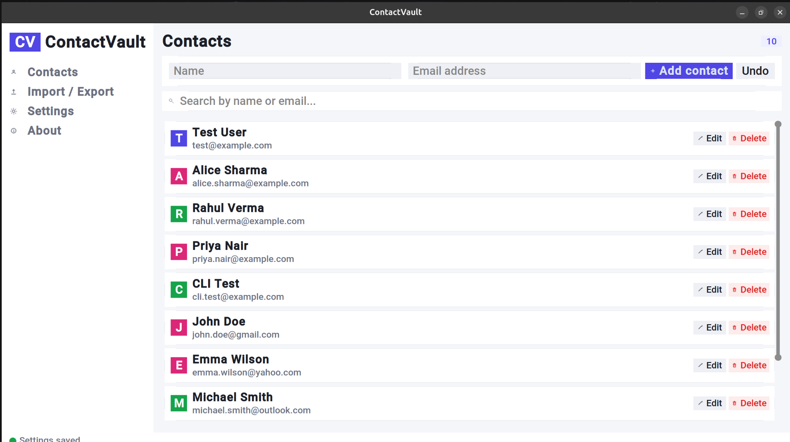
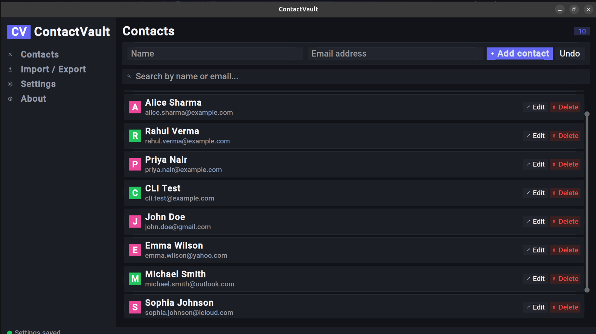
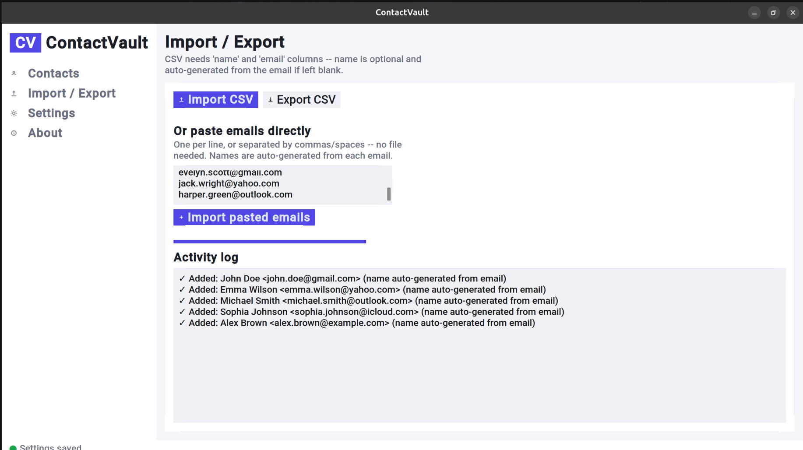
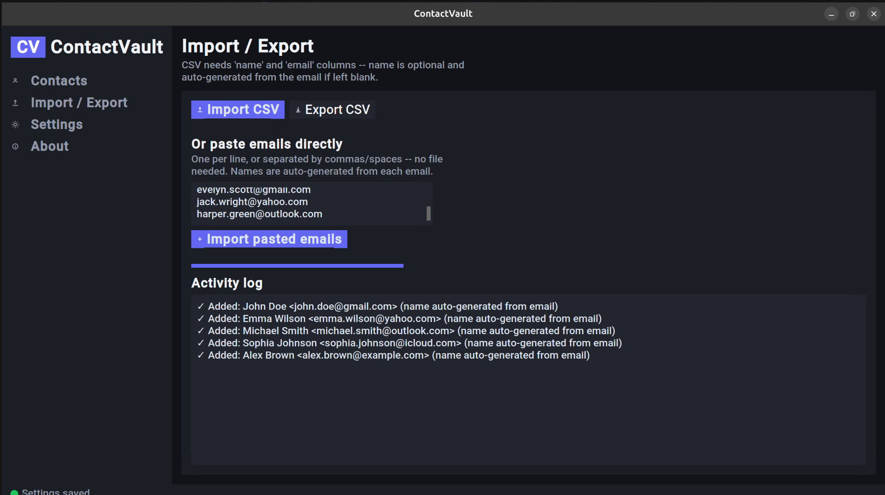
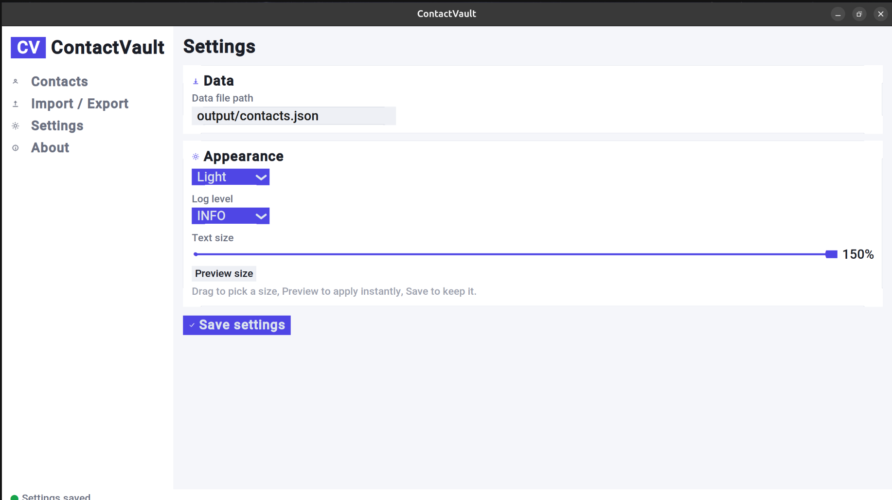
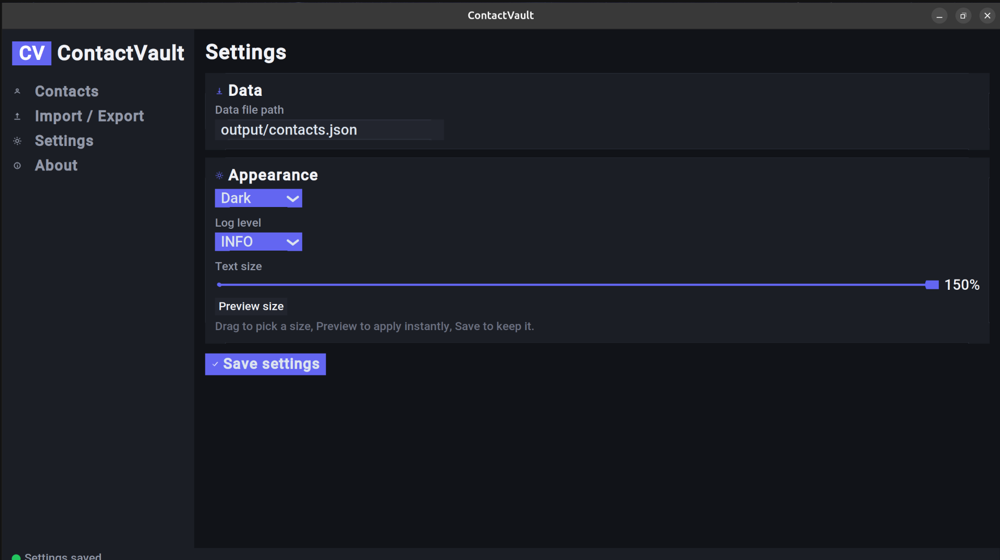
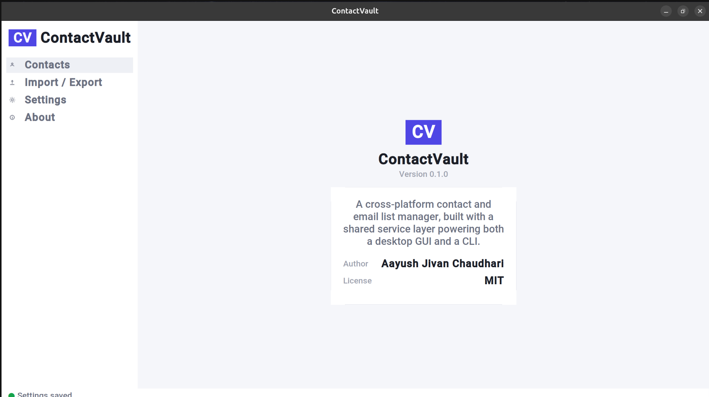
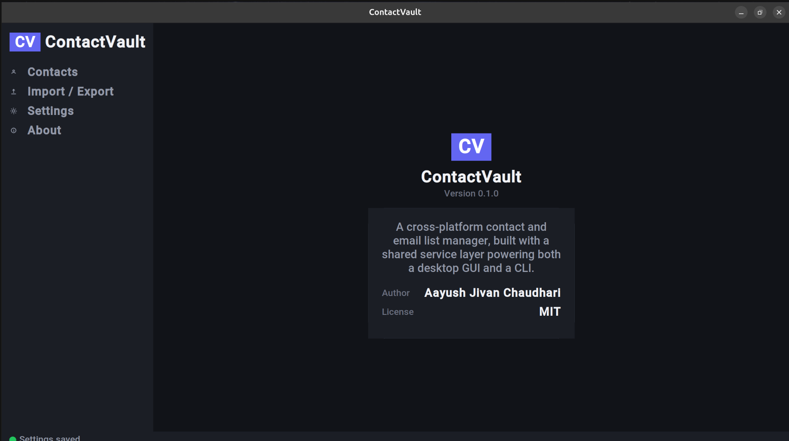

# Contact Vault

A cross-platform, production-grade contact and email list manager, with both a modern desktop GUI (CustomTkinter) and a full CLI, sharing a single validated, deduplicated data layer.

## Features

- Add, view, search, edit, and delete contacts
- Case- and Unicode-aware duplicate detection (`alice@x.com` and `ALICE@X.com` are treated as the same contact)
- Email validation via the `email-validator` library (RFC-compliant, not regex-based)
- Undo for the last add / edit / delete action (Command pattern)
- Bulk import from CSV **or** pasted emails (no file needed) — a live progress bar and per-row report of what was added vs. skipped, with names auto-generated from the email when left blank
- CSV export
- Adjustable UI text size (80%–150%), saved across restarts
- Full light/dark theme support
- Keyboard support: Enter to submit, Escape to cancel an edit or clear search, arrow/Page Up/Page Down/Home/End to scroll the contact list
- CLI with the same feature set as the GUI, for scripting and automation (`add`, `list`, `search`, `edit`, `delete`)
- Confirmation dialog before deleting a contact
- Atomic, crash-safe file writes — a failed save can never corrupt existing data
- Structured logging to `logs/`
- 52 automated tests covering business logic, validation, storage, and CLI behavior


## Screenshots

<table>
<tr>
<td align="center"><b>Light</b></td>
<td align="center"><b>Dark</b></td>
</tr>
<tr>
<td></td>
<td></td>
</tr>
<tr>
<td></td>
<td></td>
</tr>
<tr>
<td></td>
<td></td>
</tr>
<tr>
<td></td>
<td></td>
</tr>
</table>

## Installation

**Requirements:** Python 3.11+

```bash
git clone https://github.com/Aayush29052006/contactvault.git
cd contactvault
```

**Linux / macOS:**
```bash
python3 -m venv venv
source venv/bin/activate
pip install -r requirements.txt
pip install -e .
```

**Windows (PowerShell):**
```powershell
python -m venv venv
venv\Scripts\activate
pip install -r requirements.txt
pip install -e .
```

**Run the GUI:**
```bash
python3 main.py
```

**Run the CLI:**
```bash
python3 main.py add "Alice" alice@example.com
python3 main.py list
```

**Run the test suite:**
```bash
pytest -v
```

## Architecture

GUI and CLI both call a single `ContactService`, which delegates storage to a `ContactRepository`. Neither front-end contains business logic or touches the data file directly — this keeps validation, deduplication, and undo behavior in exactly one place.

See [`docs/architecture.md`](docs/architecture.md) for the full breakdown and design rationale.


## Project Structure
```
contactvault/
├── src/contactvault/   # application package (models, services, repository,
│                         validation, gui, cli, utils)
├── assets/             # icons and static assets
├── docs/                # architecture notes and guides
├── screenshots/         # app screenshots
├── tests/               # pytest suite (52 tests)
├── logs/                 # runtime logs (gitignored)
├── output/               # exported files and data (gitignored)
├── config/               # default_config.json
├── .github/workflows/    # CI (pytest across OS matrix)
├── main.py               # entry point (GUI or CLI dispatch)
└── requirements.txt
```
## Technologies Used

- Python 3.11+
- CustomTkinter — GUI, with a custom design system (color tokens, hand-drawn icon set, avatar initials)
- argparse (stdlib) — CLI
- email-validator — validation
- pytest — automated testing
- GitHub Actions — CI across Ubuntu, Windows, and macOS

## How It Works

1. **Both entry points call one service.** `main.py` checks for command-line arguments — none launches the GUI, any launches the CLI — but both paths end up calling the same `ContactService` methods.
2. **The service owns every business rule.** Validation, duplicate-checking, and undo all live in `ContactService`. The GUI and CLI only collect input and display results.
3. **Storage is abstracted behind a repository.** `ContactService` doesn't know or care that data is stored as JSON — it only knows it's talking to something that implements `load()`/`save()`. Swapping to SQLite later would mean writing one new repository class, with zero changes elsewhere.
4. **Writes are atomic.** Every save writes to a temporary file first, then swaps it into place in one step — a crash or power loss mid-save can never leave `contacts.json` half-written or corrupted.

## Future Improvements

- SQLite backend option for larger contact lists (repository pattern already supports this without touching the service layer)
- Folder-watcher for fully hands-off CSV auto-import
- Contact tags/categories
- Packaged standalone executables (PyInstaller) for one-click install on Windows/macOS/Linux without requiring Python
- Keyboard-driven row selection + Delete key to remove a contact without clicking

## License

MIT — see [LICENSE](LICENSE).

## Acknowledgements

Built as part of a professional portfolio following the Google IT Automation with Python Professional Certificate.
